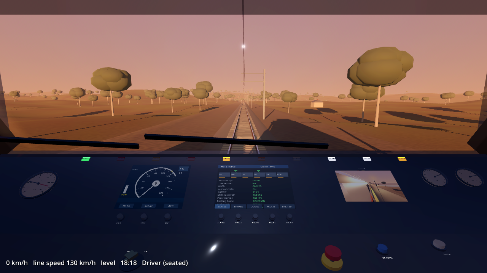
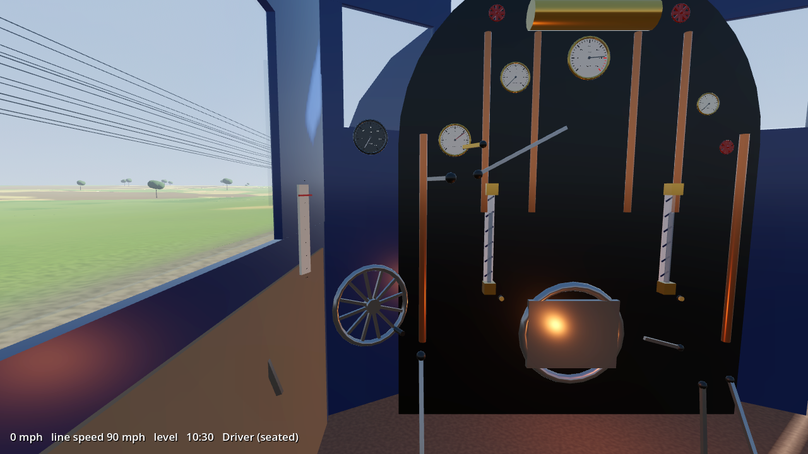
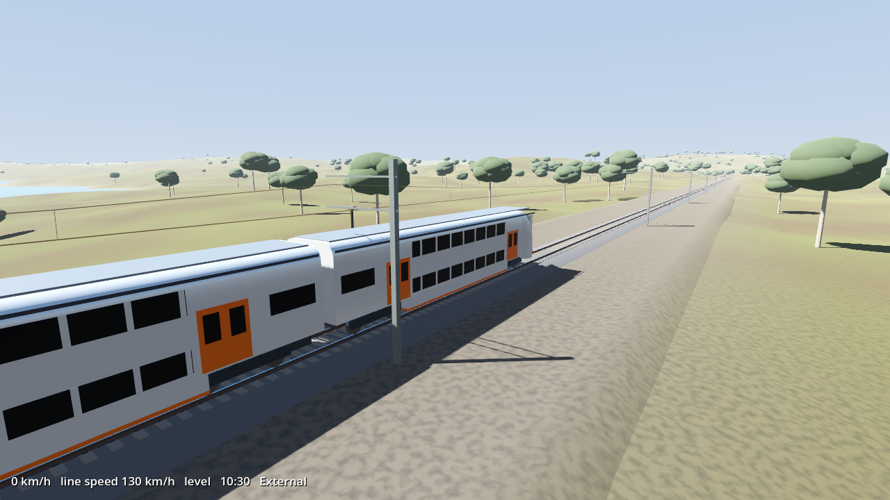
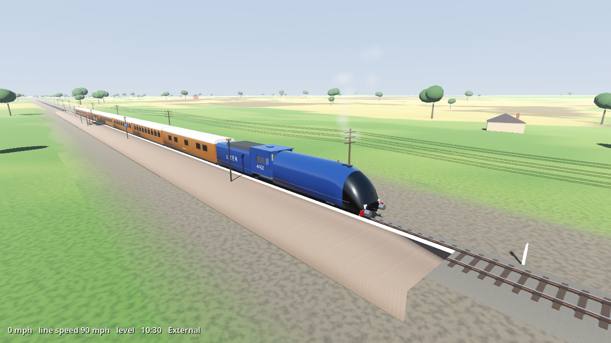

# Traingame

A realistic train-driving simulator about **starting up and driving** real trains, with every lever, switch, valve, button and circuit breaker in the cab working. Built with **Godot 4.6** for **Windows and Linux** (Fedora included).

Made by **Lex Sclavos**.

| Mariyung cab | LNER A4 footplate |
|---|---|
|  |  |
|  |  |

## The trains

### NSW D set "Mariyung" (electric multiple unit)
Double-deck intercity EMU (Hyundai Rotem, Mitsubishi IGBT-VVVF, 1500 V DC overhead). 4, 6, 8 (4+4) or 10 (6+4) car trains.

Simulated systems:
- **Battery isolation switch** and **12 circuit breakers** on the rear cab panel. Each one disables its system when off.
- **Master key** to activate the cab. TMS and ETCS DMI boot up.
- **Pantograph** with a battery-powered auxiliary compressor to raise it when the main reservoir is empty, plus line voltage.
- **High-speed circuit breaker** and **auxiliary converter (SIV)**, which powers the 415 V AC compressor, battery charger, HVAC and lights.
- **Main reservoir** air with compressor governor, **spring parking brake** (needs 500 kPa to release).
- **Combined traction/brake controller**: P1-P4 power, B1-B7 blended regenerative + EP friction brakes, and EB. Jerk limiting, holding brake at a stand, wheel slip and wheel-slide protection, rain reduces adhesion.
- **Direction controller** with interlocks, **plug doors** (left/right release, close with chimes, traction interlock, wrong-side warning).
- **Vigilance** (60 s, lamp, buzzer, penalty), **driver's safety pedal**, **emergency stop** mushroom, **EB reset** procedure.
- **ETCS**: Start of Mission (DATA, START), Staff Responsible until the first balise, then Full Supervision with braking curves, a warning at +2 km/h, service brake intervention at +5 and an emergency trip at +10.
- **TMS** screen with status, brakes, doors and faults pages and an **automatic brake test**. A live **CCTV** monitor, headlights, marker and tail lights, wipers, washer, cab and desk lights, demister, HVAC, PA chime and a two-tone horn.

Real figures used: 20.4 m cars, 3.03 m wide, 4.40 m tall, 4-car 199.8 t / 6-car 298 t, 160 km/h design and 130 km/h service speed, 0.84 m/s² acceleration, 1.01 m/s² service and 1.10 m/s² emergency braking.

### LNER A4 4468 "Mallard" (steam)
Gresley's streamlined Pacific, holder of the steam speed record (126 mph, Stoke Bank, 3 July 1938). Choose 0-14 coaches, plus the dynamometer car if you want the record train (240 tons).

Simulated systems:
- **Boiler** thermodynamics: water mass and temperature, saturation pressure, safety valves at 250 psi, heat losses, two **water gauge glasses** with test cocks, swell, and the level surging on gradients and braking.
- **Fire** across four parts of the grate: firing each part, fresh coal cooling it, holes in a thin fire, clinker, fire spreading. **Front and back dampers**, a **firehole door** that gives secondary air or chills the boiler, black smoke when fired badly, **firelighters** for a cold start.
- **Blower** and **Kylchap double blastpipe** draught: harder working means more air through the fire.
- **Regulator** (first valve and main valve), **screw reverser** (cut-off), with steam flow through the regulator, superheater and valve events. Wire-drawing is fitted to the speeds recorded on the record run.
- **Exhaust steam injector** and **live steam injector** with separate water and steam valves. Get the order or water setting wrong and they waste at the overflow.
- **Vacuum brake** with large and small ejectors, a 21 in relief valve, the brake application travelling down the train, per-vehicle reservoir chambers, and cast-iron shoe friction falling off with speed. **Tender hand brake.**
- **Wheelslip** (adhesion, steam sanders), **cylinder cocks**, condensate in cold cylinders, **priming**, **hydraulic lock** (blown cylinder cover), **dropping the fusible plug**, **blowback**.
- **Water troughs and scoop** (lower above 30 mph, lift before the end!), chime whistle, carriage steam heat, gauge lamp.
- **Driver or fireman**: an **AI fireman** (F5) and an **AI driver** (F6, you fire) can cover either job.

Real figures used: 3 cylinders 18½ × 26 in, 6 ft 8 in drivers, 250 psi, giving **35,455 lbf** tractive effort (the sim reproduces this), 41¼ sq ft grate, 5,000 gallon / 8 ton tender, loco 102 tons 19 cwt.

### Checked against reality
The physics is tested headlessly (`tests/`), and these checks run on every push:

| Check | Result in the sim | Real figure |
|---|---|---|
| A4 starting tractive effort | 35,200 lbf (at 250 psi) | 35,455 lbf |
| A4 engine model down a 1 in 200 bank, 40% cut-off from 75 mph, boiler held at 235 psi | 87, 96, 104, 109, 114, 118 mph at each mile | 87.5, 96.5, 104, 107, 111.5, 116 mph (1938) |
| Same run in the full sim with the AI fireman (boiler can't keep up, pressure falls to ~175 psi) | ~97 mph at the bottom | 126 mph needed a perfectly prepared fire and boiler |
| A4 vacuum brake stop from 75 mph | 1.14 miles | about 1 mile |
| A4 raising steam from cold | about 4 hours | 4-6 hours |
| Mariyung service brake | 1.05-1.1 m/s² | 1.01 m/s² |
| Mariyung acceleration (30% load) | 0.76 m/s² | 0.84 m/s² tare |

## Routes
Both routes are continuous loops with curves, transition spirals, superelevation (cant), gradients, speed boards and distance posts.
- **Hawkesbury Loop** (17.7 km): NSW-style electrified line with sandstone cuttings, bridges, gum trees, a 1 in 40 bank, curves down to 300 m radius, and a platform at Wattle Gully.
- **Stoke Bank Loop** (43.4 km): a 1930s East Coast Main Line-style circuit with telegraph poles, bullhead rail on chairs, jointed track, 11 km of 1 in 200 descent for record attempts, and water troughs.

Take a curve too fast and you derail.

## Running it

### Play from the editor (any OS)
1. Install **Godot 4.6** (standard build, not .NET):
   - **Fedora**: `flatpak install flathub org.godotengine.Godot`, or download from [godotengine.org](https://godotengine.org/download/linux/).
   - **Windows**: download from [godotengine.org](https://godotengine.org/download/windows/) (or Steam).
2. Clone this repo, open Godot, click **Import**, choose `project.godot`.
3. Press **F5** to play.

### Ready-made builds
Every push to `main` builds Windows and Linux versions with GitHub Actions. Open the **Actions** tab, pick the latest run, and download `traingame-windows` or `traingame-linux` from **Artifacts**. Pushing a tag like `v0.1.0` also creates a **Release** with both zips.

To export yourself: *Project → Export*, install the export templates when asked, and choose **Linux** or **Windows Desktop**.

## Controls

**Mouse:** hover over anything for its name, state and an explanation. **Left-drag** levers and wheels, **click** buttons and switches (right-click turns rotary switches back), **scroll** to adjust whatever is under the cursor, **hold right mouse** to look around.

| Key | Everywhere |
|---|---|
| 1 / 2 | cycle cab positions / second position (fireman, or the Mariyung rear panel) |
| 3 / 4 | outside camera (drag to orbit, scroll to zoom) / lineside camera |
| + / − | time acceleration up to ×120 (for raising steam or charging air) |
| F1 / F2 / F3 | help / **start-up checklist** / technical details |
| Esc | pause menu |

| Key | Mariyung | Mallard |
|---|---|---|
| A / D | controller towards brake / power | regulator close / open |
| W / S | direction controller | reverser forward / back |
| ; / ' | | vacuum brake release / apply |
| Space / N | horn high / low | chime whistle |
| Backspace | controller to EB | shut regulator, full brake |
| Q | acknowledge vigilance / ETCS | |
| F | driver's safety pedal | |
| K, P, H, L | key, pantograph, HSCB, headlights | |
| T / Y / U | doors left / right / close | |
| J, X, C | | large ejector, sanders, cylinder cocks |
| R, E, Z | | firehole door, fire a shovelful, choose part of the grate |
| B, I, O | | blower, live injector, exhaust injector |
| F5 / F6, PgUp/PgDn | | AI fireman / AI driver, AI driver speed |

## Start-up from cold

Press **F2** in game for a live checklist that ticks itself off.

**Mariyung:** rear panel (key 2): battery ON → master key ON → wait for TMS/DMI → PAN UP (aux compressor charges first) → HSCB close → aux converter starts → main reservoir to 750 kPa (use +) → park brake release → DMI: DATA then START → TMS: BRAKE TEST with the controller in B7 → headlights → direction FORWARD → doors closed → foot on the safety pedal (F) → power.

**Mallard:** check the glass → open the firehole door, fire 15-20 shovelfuls around the grate → firelighters → dampers open, door almost shut → (time ×60-120) build the fire as pressure rises → blower on above about 40 psi → near 250 psi: test the gauge glass and an injector → large ejector until 21 in, then small ejector → tender hand brake off → cylinder cocks open, reverser full forward, whistle, ease the regulator → close the cocks once she's warm → notch up as speed rises.

## Project layout
```
scripts/
  core/game_settings.gd   menu settings and key map (autoload)
  track/                  route definitions and the track geometry
  world/                  terrain, track meshes, overhead wiring, scenery, sky, steam effects
  train/                  vehicles, procedural models, train physics
  cab/                    interactive controls, gauges, screens, and the two cabs
  sim/                    Mariyung electrics/air/safety systems and the A4 boiler/fire/steam engine
  player/camera_rig.gd    cab views, free look, picking controls
  ui/                     main menu and HUD
  audio/train_audio.gd    synthesised sound (no audio files)
tests/                    headless physics checks and screenshot scripts
```
Everything is built from code: no binary models, textures or sounds. To tinker:
- **New route:** add an entry in `scripts/track/route_defs.gd`. Half of a loop is listed as straights and curves that turn exactly 180°, and the builder mirrors it so the loop always closes.
- **New train:** a model in `vehicle_models.gd`, a cab script extending `Cab`, and a sim extending `TrainSim`.
- **Better models:** swap the procedural meshes for Blender `.glb` models. Controls just need a `CabControl` node with a pick box.

Run the checks yourself:
```
godot --headless --path . -s res://tests/run_sim_test.gd -- a4
godot --headless --path . -s res://tests/run_sim_test.gd -- mariyung
```

## Realism notes
- The **A4** is built from published dimensions and performance. The cab layout is a faithful approximation; exact fitting positions vary between photographs and eras.
- The **Mariyung's** published performance figures are used directly. Its cab layout, start-up order, ETCS behaviour and TMS pages follow general modern NSW EMU and ETCS practice rather than the exact (unpublished) D set procedures.
- Both routes are fictional, styled on the Hawkesbury/Central Coast line and the ECML around Stoke Bank.

## Roadmap ideas
Loading and unloading of passengers and cargo, station stops with dwell times, signals and other trains, more locomotives, and Blender-modelled cabs.
